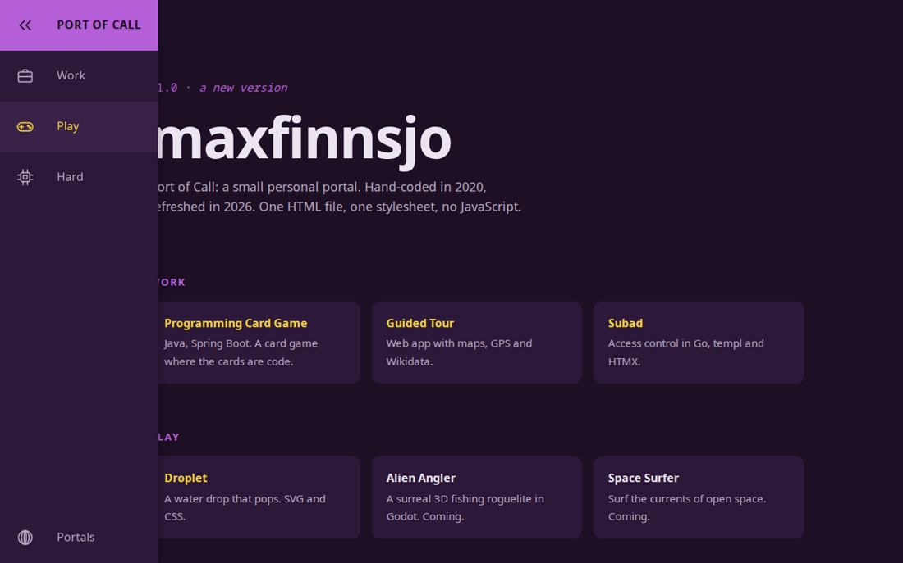
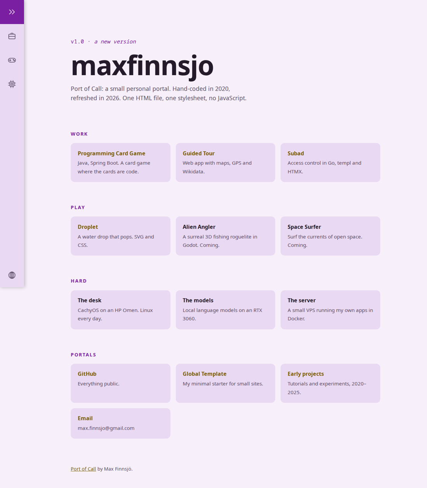
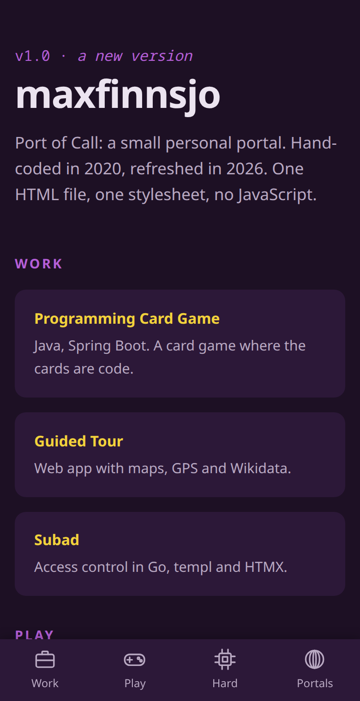

# Port of Call

A small personal portal: Work, Play, Hard and Portals behind an icon rail. One HTML file, one stylesheet, no JavaScript.

**Live demo:** [maxfinnsjo.github.io/port-of-call](https://maxfinnsjo.github.io/port-of-call/)

## How it works

- **The rail.** On phones it's a bottom tab bar. On larger screens it's a narrow icon rail that widens on hover or keyboard focus (`:focus-within`), so it works without a mouse and without JavaScript.
- **One stylesheet, read top to bottom:** tokens, base, rail, page, tiles. Native CSS nesting keeps related rules together.
- **Own icons.** Hand-drawn inline SVGs that inherit the text colour.
- **Light and dark** from the same tokens, following the system setting.

  
  

## History

First built in March 2020 as version 0.4.9 of a portfolio portal, with Sass, normalize.css and a slide-out menu. Refreshed in 2026 as v1.0: the purple and yellow stayed, the build step and JavaScript went, and the menu became a rail that works by hover, focus or tap.
